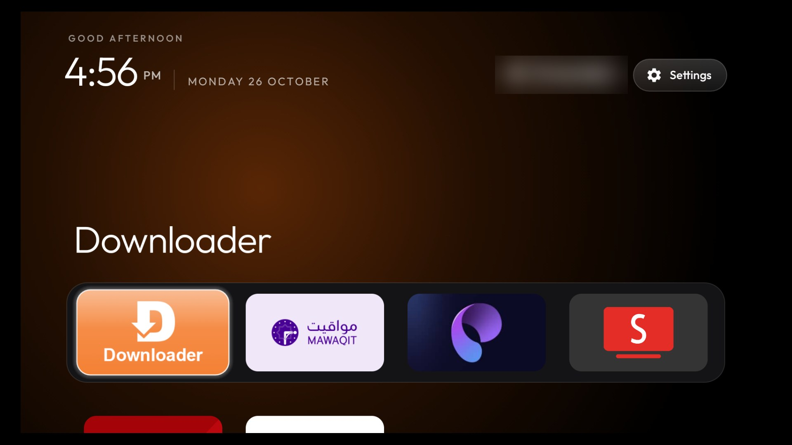

# Fire OS 6 fork

This fork of [cleanyourtv](https://github.com/Gathin23/cleanyourtv) makes its launcher run on Fire OS 6
(Android 7.1), where upstream's launcher can't be installed and Amazon's home screen can't be replaced.
Everything else is upstream's, and the branch is kept merged with it.



Tested on a Fire TV Stick 4K, 1st gen (AFTMM, mantis), Fire OS 6.7.1.1, build NS6711, Android 7.1.2.

## What it changes

- **minSdk 25.** Upstream's launcher needs Android 8. `java.time` comes from core library desugaring, and the
  three calls Android 7 lacks have fallbacks: `getChangedPackages` (the package receiver already covers it),
  hardware bitmaps and `Files.readAllLines`.
- **Outfit on Android 7.** Android 7 can't load font XML or variable-font weights, so every label would fall back
  to Roboto. Static 200/300/400/500 cuts of Outfit sit in `res/font/outfit_w*.ttf`; `UiFont` hands them out below
  Android 8, and `LegacyFonts`, a layout factory installed only below Android 8, applies them to layouts.
- **Home on Fire OS 6** (`FireHomeWatcher`). Fire OS ignores the default-home setting, refuses to disable
  Amazon's launcher (a protected package) and, on 6.7, never binds a third-party accessibility service, so
  upstream's `HomeKeyService` route doesn't work. Every Home press makes the system log a start of Amazon's home
  from uid 1000. The watcher waits on that log line (a blocking read, no polling) and brings the launcher back.
  - Android 7 holds back activity starts from background apps for five seconds after Home. The watcher moves the
    launcher's existing task to the front with `ActivityManager.AppTask.moveToFront()`, which runs under the
    system's identity and isn't held back. The launcher is up about 0.5 s after Home (about 1.2 s out of
    YouTube), with no overlay permission.
  - Settings also passes through Amazon's home, but from the settings app's uid, so the watcher leaves it alone.
  - After a reboot the watcher and the launcher start from `BOOT_COMPLETED` at priority 999: at the default
    priority Fire OS delivered it about 40 s after Amazon's home was up; at 999 the launcher takes over about
    6 s after it.
  - It only runs when `READ_LOGS` has been granted, which `build-and-install.sh` does only with
    `FIRE_OS_HOME_WATCHER=1`. On any other TV it never starts.

What it costs: the APK is about 784 KB instead of about 536 KB (the desugared `java.time` library and the four
font cuts), over upstream's 576 KB CI gate. Amazon's home screen still runs in the background and shows for
about half a second on each Home press.

## Install on Fire OS 6

1. Debloat first with [`examples/amazon-fire-tv-stick-4k-2018/`](examples/amazon-fire-tv-stick-4k-2018/), as
   upstream describes. Settings → My Fire TV → Developer options → ADB debugging on.
2. Build and install with the watcher:

   ```bash
   TV_HOST=192.168.1.50 FIRE_OS_HOME_WATCHER=1 launcher/build-and-install.sh
   ```

   Amazon's launcher stays enabled (Fire OS won't disable it); nothing is disabled by this step.
3. Press Home on the remote: the launcher comes up over Amazon's home.

To undo: `tools/tv.py 'pm disable-user --user 0 com.gathin.tvhome'` (or `pm enable` to bring it back). Amazon's
home takes over again at once.

## Permissions beyond upstream's

| Permission | Why |
|---|---|
| `READ_LOGS` | Reading the system log for Home presses. A development permission: only `pm grant` over ADB gives it. |
| `RECEIVE_BOOT_COMPLETED` | Starting the watcher and the launcher after a reboot. Does nothing without `READ_LOGS`. |

No network permission, no accessibility service, no overlay.
